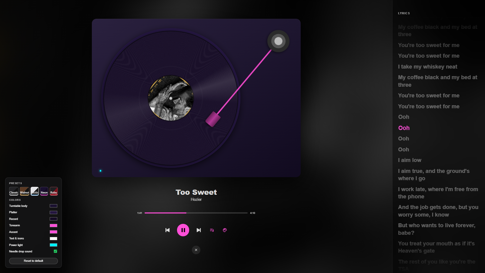

# Vinyl BG

A turntable view for Spotify, built with [Spicetify](https://spicetify.app).



## Features

- **Spinning record** with the current song's album art as the label, over a blurred album-art background.
- **Tonearm that follows the song.** It drops onto the outer groove when you press play and moves toward the label as the song plays, reaching it as the song ends.
- **Needle-drop scratch.** When you press play, the needle lands with a scratch and the song starts halfway through it. You can turn the sound off.
- **Synced lyrics** in a side panel. The current line is highlighted, and clicking a line jumps to it. Lyrics come from Spotify, with [lrclib.net](https://lrclib.net) as a fallback.
- **Colour customisation** with presets (Classic, Walnut, Arctic, Neon, Ruby) and pickers for the body, platter, record, tonearm, accent, text and power light.

## Usage

Click the record icon in the top-left of the Spotify window, next to the back/forward arrows.

| Key | Action |
| --- | --- |
| Space | Play / pause |
| ← / → | Previous / next track |
| L | Toggle lyrics |
| C | Toggle colours |
| Esc | Close |

Clicking the record also plays or pauses, and clicking the progress bar seeks.

## Install

**Marketplace:** search for "Vinyl BG" in the Spicetify Marketplace.

**Manual:** copy `vinyl-bg.js` into your Spicetify `Extensions` folder, then run:

```
spicetify config extensions vinyl-bg.js
spicetify apply
```
